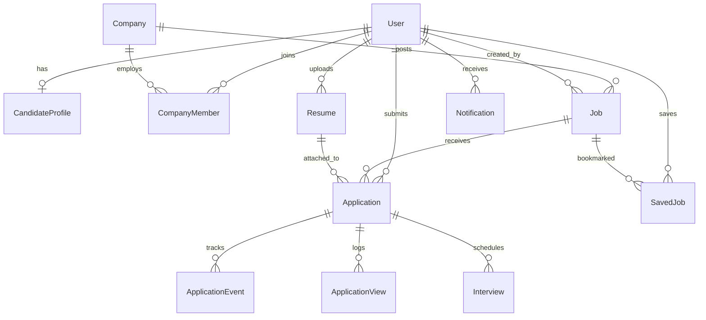

# SmartHire — Relational Database Design

## Schema Overview
- **ORM:** Prisma 5.22
- **Dialect:** SQLite (dev) / PostgreSQL (production compatible)

## Tables & Primary Keys

1. **`User`**: Core user entity (`id`, `fullName`, `email`, `passwordHash`, `role`, `accountStatus`, `createdAt`).
2. **`CandidateProfile`**: Candidate headline, location, education, experience, skills, bio.
3. **`Company`**: Company profile, description, logo, and `verificationStatus` (`PENDING`, `VERIFIED`, `REJECTED`).
4. **`CompanyMember`**: Associates recruiter user to company.
5. **`Job`**: Published job listing (`id`, `companyId`, `postedBy`, `title`, `description`, `workMode`, `employmentType`, `salaryMin`, `salaryMax`, `applicationDeadline`, `status`).
6. **`Resume`**: Candidate PDF files with storage metadata (`id`, `candidateId`, `originalFilename`, `storageKey`, `fileSize`, `uploadedAt`).
7. **`Application`**: Candidate job application with unique constraint `[jobId, candidateId]` and lifecycle `status` (`SUBMITTED`, `UNDER_REVIEW`, `SHORTLISTED`, `INTERVIEW_SCHEDULED`, `INTERVIEW_COMPLETED`, `OFFER_EXTENDED`, `HIRED`, `REJECTED`, `WITHDRAWN`).
8. **`ApplicationView`**: Authentic recruiter view audit trail (`id`, `applicationId`, `recruiterId`, `viewType`, `viewedAt`).
9. **`ApplicationEvent`**: Sequential milestone audit log for the visual ATS timeline (`id`, `applicationId`, `actorId`, `eventType`, `previousStatus`, `newStatus`, `eventTimestamp`, `metadata`).
10. **`Interview`**: Scheduled interview records (`id`, `applicationId`, `scheduledBy`, `interviewDate`, `startTime`, `endTime`, `interviewMode`, `interviewLocation`, `meetingLink`, `interviewerName`, `instructions`, `status`, `candidateResponse`).
11. **`Notification`**: Real-time & persistent in-app notifications (`id`, `userId`, `type`, `title`, `message`, `relatedApplicationId`, `relatedInterviewId`, `isRead`, `createdAt`).
12. **`SavedJob`**: Candidate bookmarks with unique `[candidateId, jobId]`.
13. **`NotificationDelivery`**: Multi-channel delivery records (`IN_APP`, `EMAIL`).
14. **`AdminAuditLog`**: Administrative governance and security action logs.
